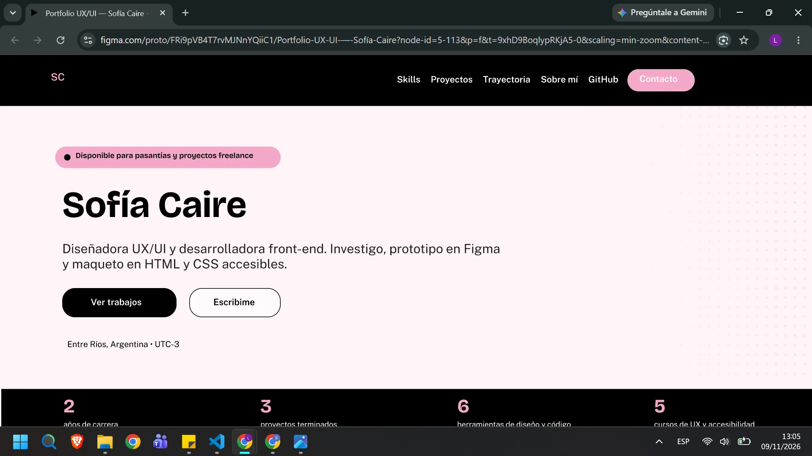
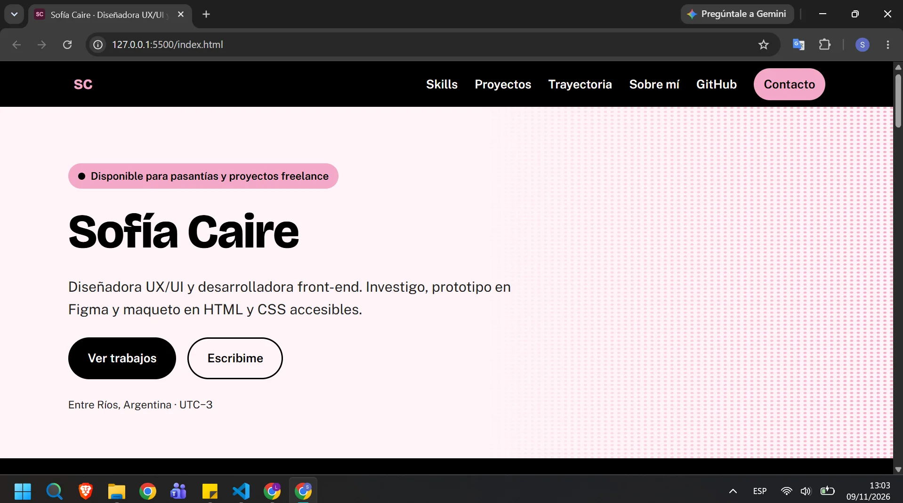
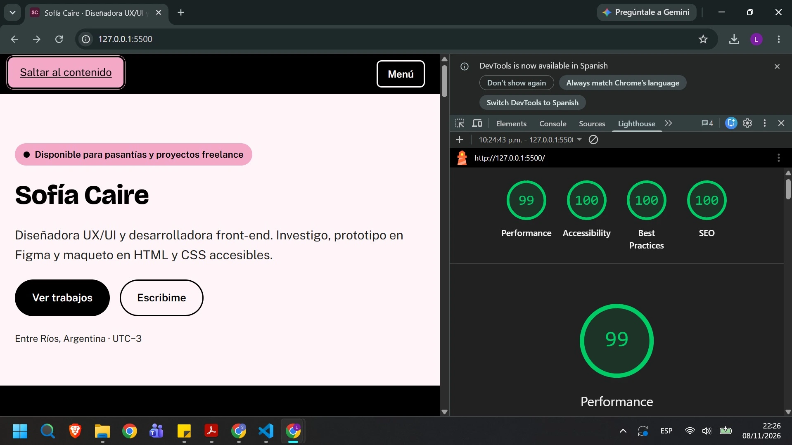

# Portfolio | Sofía Caire

Portfolio personal de Diseño UX/UI desarrollado como proyecto académico para la Licenciatura en Sistemas de Información de la FCyT.

## Información general
- **Sitio:** https://sofiacaire-portfolio.netlify.app/
- **Repositorio:** https://github.com/sofiacaire/TP6-blogPersonal.git
- **Figma:** [enlace privado con permiso de visualización](https://www.figma.com/design/FRi9pVB4T7rvMJNnYQiiC1/Portfolio-UX-UI-%E2%80%94-Sof%C3%ADa-Caire?node-id=5-2&t=cWts8haqMdtqjDqN-1)
- **Stack:** HTML5, CSS3 y JavaScript vanilla.
- **Arquitectura:** sitio estático sin framework, con variables en `:root`, estilos reutilizables y estructura semántica.
- **Tipografías:** Bricolage Grotesque y Public Sans (Google Fonts, `display=swap`).
- **Diseño:** proyecto original, sin templates ni bibliotecas visuales.

## Proyecto
Este portfolio tiene como objetivo presentar la identidad visual y la experiencia de usuario de Sofía Caire como diseñadora UX/UI. La propuesta combina una estética sobria y moderna, con foco en legibilidad, accesibilidad, navegación clara y presentación de trabajos en un formato profesional.

La interfaz incluye:
- experiencias de navegación adaptadas a mobile
- menú mobile interactivo con JavaScript vanilla y una página de caso de estudio
- atención a contraste, teclado y accesibilidad
- estructura visual pensada para exhibir un portfolio académico y personal

## Proceso de diseño
El proceso UX/UI está documentado en el [archivo de Figma](https://www.figma.com/design/FRi9pVB4T7rvMJNnYQiiC1/Portfolio-UX-UI-%E2%80%94-Sof%C3%ADa-Caire?node-id=5-2&t=cWts8haqMdtqjDqN-1), disponible para visualizar. Incluye:
- protopersona y benchmark
- test de usabilidad con 3 personas y cambios aplicados
- moodboard y concepto visual
- arquitectura de información
- wireframes y prototipos
- design system

## IA y validación
- **Uso de IA:** el HTML/CSS base y los textos de ejemplo se generaron con ChatGPT. Luego fueron revisados, adaptados y personalizados para reflejar mi trabajo y mi estilo.
- **Validación:** contrastes, navegación por teclado y estructura accesible fueron revisados con Lighthouse y WAVE.

## Despliegue
- **URL de producción:** https://sofiacaire-portfolio.netlify.app/
- El sitio se publica como proyecto estático desde la raíz del repositorio.
- No requiere build ni dependencias adicionales.
- Netlify despliega automáticamente cada vez que se realiza un `git push` a la rama configurada.
- La ruta `404.html` está preparada para manejar páginas no encontradas.

## Capturas

### Fidelidad: Figma vs. sitio web
Figma:

Sitio web: 

### Performance: Lighthouse mobile

